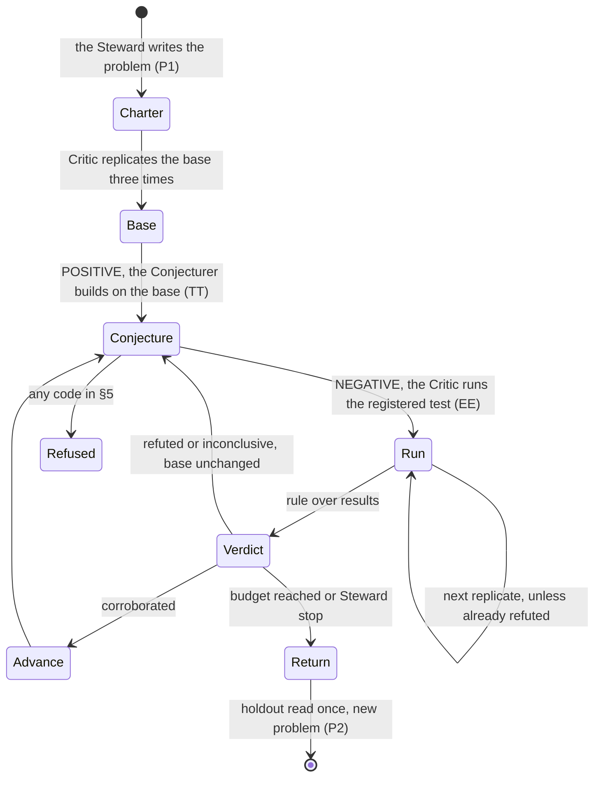

# `follow-agent-contract` — the popper contract

`type: resource.contract` · `spec: agent.contract` · normative. Every other file is subordinate to this one.

popper researches at the edge between two worlds. In the theory world a machine conjectures; in the data world a frozen evaluator reports a number. The only thing that crosses the edge is a **verdict**: an observed result read against a prediction that was fixed before the result existed. This is Popper's asymmetry made into a law (no number of passing runs proves a conjecture, one failing run refutes it), and a pair of feedback loops in the cybernetic sense made into a file format: a positive loop that amplifies what has survived, and a negative loop that removes what has not.

## Specification

```json { type: notebook.cell }
{
  "id": "docs/follow-agent-contract.md",
  "type": "resource.contract",
  "role": "define the two worlds, the edge, the trace, flow laws, refusals and predicates",
  "reads": ["DISCLAIMER", "research.json", "ooc/popper.og"],
  "writes": [],
  "must": ["every advance passes through the data", "predict before running", "the Critic alone runs and judges", "only the Steward charters", "corroborated is never true", "the holdout is read once", "append only", "match codes, not prose"],
  "check": ["R1-R13"]
}
```

## Graph

- ← [read-repository.md](read-repository.md)
- → [pin-sources.md](pin-sources.md)
- → [vary-cybernetics.md](vary-cybernetics.md)
- → [../skills/conjecture-hypothesis.md](../skills/conjecture-hypothesis.md)
- → [../skills/refute-experiment.md](../skills/refute-experiment.md)
- → [../systems/loop-research.md](../systems/loop-research.md)

## Composition

```toml { type: notebook.cell }
config = "research.json"                 # source pin, testbed, data, critic rule, charter defaults
index = "ooc/popper.og"                  # ObjectGraph traversal index
skills = ["skills/conjecture-hypothesis.md", "skills/refute-experiment.md"]
system = "systems/loop-research.md"      # LOOP(data) { POSITIVE hypothesis; NEGATIVE experiments; } RETURN
variant = "docs/vary-cybernetics.md"     # what changed from tulip and from autoresearch, and why
store = "one trace per charter"          # JSON Lines, append only, root-chained (§3)
```

## Indications

- An agent is asked to run experiments autonomously, and each kept change must be explainable by a prediction that could have failed and did not.
- A Steward wants to leave an autoresearch-style loop running unattended and read back, in the morning, which ideas were refuted, which survived, and whether the survivors hold on data the loop never saw.
- A reviewer must tell a corroborated result from a lucky one.

## Contraindications

- Not a hill climber. A change is never kept because one run came out lower (§4.3, `self_verdict`).
- Not a verifier. Nothing in popper is ever called true, proven, confirmed or verified (`verification`).
- Not a closed loop without a check. The base never advances twice without a corroborated verdict between (§4.1, `closed_loop`).
- Not a way to move the goalposts. The evaluator, the data split, the seed protocol and the decision rule are fixed by the charter and the pins; a conjecture may not touch them (`drift`, `confound`, `ad_hoc`).
- Not unattended forever. The source's loop never stops; popper's loop returns at the charter's budget or when the Steward stops it (§4.8).

## §0 Roles and IDs

| Role | World | Does | Never |
|---|---|---|---|
| **Steward** | human | writes the charter: the problem, the testbed, `delta_min`, the budget; may stop or amend | conjectures, runs, judges, reads the holdout before RETURN |
| **Conjecturer** | theory (positive) | proposes one hypothesis at a time: a diff and a prediction; reads the whole trace (Type II) | runs, judges, edits a registered prediction, touches a frozen file |
| **Critic** | data (negative) | runs the registered test exactly: seeds, replicates, rule; emits the verdict (Type I) | reads the rationale, chooses which runs count, reruns a refuted arm |
| **Recorder** | frame | writes notebook entries to the Steward from the trace | invents an event, calls a conjecture true |

The Conjecturer, the Critic and the Recorder are the same agent following different files: `skills/conjecture-hypothesis.md`, `skills/refute-experiment.md` and `systems/loop-research.md`. The Steward is a person; an agent may not write or amend a charter (`self_charter`). The evaluator (`prepare.py` `evaluate_bpb` at the pin) is not a role; it is the data world's only voice.

```text { type: notebook.cell }
testbed := ^testbed:[a-z0-9-]{2,32}$          # research.json testbed.id
kind    := improves | simplifies
verdict := corroborated | refuted | inconclusive
seq     := ^[1-9][0-9]*$                       # position of an event in its trace
```

## §1 Objects

```text { type: notebook.cell }
Pin        = { url: URL, digest: "sha256:" hex, licence: String | null }
Charter    = { problem: String, testbed, delta_min: Number, max_tested: Integer, holdout_delta: Number, tag: String }
Prediction = { kind, delta: Number, forbids: String }        # fixed before any run of its arm
Conjecture = { claim: String, diff: Patch, base: commit, prediction: Prediction, rescues?: seq }
Arm        = { commit, seeds: [Integer; 3] }                 # the code under test and its derived seeds
Run        = { arm: seq, i: 1..3, seed: Integer, commit }    # one uv run of train.py
Result     = { run: seq, val_bpb: Number | null, memory_gb: Number, status: "ok" | "crash" | "timeout" }
Verdict    = { conjecture: seq, verdict, h: [Number], b: [Number], bits: 0 | 1 }
Advance    = { from: commit, to: commit }                    # the base moves; only after corroborated
Event      = { seq, world: "human" | "theory" | "data" | "frame", kind, body, cites: [seq] }
Trace      = [Event]                                         # append only
Notebook   = notes(Trace)                                    # what the Steward reads
```

| `world` | `kind` | `body` | `cites` |
|---|---|---|---|
| `human` | `charter`, `amend`, `stop` | `Charter`, or a reason | the charter it amends or stops |
| `theory` | `conjecture` | `Conjecture` | the base's verdict, and any refuted conjecture it learns from |
| `data` | `run` | `Run` | the conjecture (or charter, for the base; or the last verdict, for the holdout) it tests |
| `data` | `result` | `Result` | its run |
| `data` | `verdict` | `Verdict` | the conjecture and every result it reads |
| `data` | `advance` | `Advance` | a corroborated verdict |
| `frame` | `note` | prose to the Steward, §6 | every event it reports |
| `frame` | `return` | §4.8 | every verdict |

## §2 Two worlds and the edge

- The **edge** is the set of `verdict` events. It is precise: each verdict carries at most one bit.
- `bits(verdict) = 1` when the registered prediction forbids some outcomes of the metric and allows others, so that the test could have gone either way. A prediction that forbids nothing ("may change val_bpb") or everything carries 0 bits and is refused before it runs (`unfalsifiable`). This is tulip's illusory fork, moved to the other side of the edge: a test that cannot fail tells You nothing.
- An `inconclusive` verdict (a crash or a timeout) carries 0 bits. It is not a refutation; it is an experiment that did not happen.
- `edge(trace) = Σ bits(verdict)`: how much the data has told the loop. Refutations count exactly as much as corroborations.
- A corroborated conjecture is **not** shown true. It is the best-tested conjecture so far, and every later test may still refute it (`docs/vary-cybernetics.md` P5).

## §3 Algebra

```text { type: notebook.cell }
hex(x)      = 64 lowercase hex characters of a SHA-256 digest
ehash(e)    = hex(sha256(JCS(e)))                      # RFC 8785 JCS
root(empty) = hex(sha256("popper/1"))                  # research.json loop.root_empty
root(w · e) = hex(sha256(root(w) || ehash(e)))         # || joins two hex strings, hashed as UTF-8
seed(r, i)  = int(hex(sha256(r || "seed/" || i))[0:8], 16)   # r = root just after the event that registers the arm
```

- **Monoid.** Traces compose by concatenation; the empty trace is the identity.
- **Registration by chaining.** A prediction is registered when its `conjecture` event is in the chain. Any later edit changes every later root (`broken_chain`), so a prediction cannot be changed after a result without detection.
- **Seeds are a declared clinamen.** The Critic's seeds come from the root after registration, so the Conjecturer cannot choose them, and a replay derives the same seeds.
- **Determinism of the rule.** `verdict` is a pure function of the prediction, the base results and the arm results. Replaying the results of a trace gives the same verdicts and the same root.
- **Exactness of the test.** For `improves`, three arm runs against three base runs with independent seeds: if the conjecture has no effect, the six values are exchangeable and the chance that all three arm values fall below all three base values is `1 / C(6,3) = 1/20 = 0.05`.

## §4 Flow laws



1. **Every advance passes through the data.** Between two `advance` events there is a `verdict: corroborated` that the second advance cites. A base that moves for any other reason is refused (`closed_loop`).
2. **Predict before running.** A `run` of an arm cites a `conjecture` event earlier in the chain. A run with no registered prediction (`unregistered`), or a prediction event after its first run (`post_hoc`), is refused.
3. **Only the rule judges.** `verdict` is computed by `skills/refute-experiment.md` from `research.json` `critic.test`. "Looks promising", "probably noise", "close enough" are not verdicts (`self_verdict`).
4. **The Critic is reactive.** It reads the diff, the kind, `delta`, the base results and its own run results. It never reads the claim's rationale, the notebook or the Conjecturer's earlier ideas (`stateful`).
5. **The testbed is fixed.** A diff touches only `research.json` `testbed.edit`, adds no dependency, and leaves the frozen files' bytes equal to their pins (`out_of_scope`, `drift`). It never touches the seed lines, the time budget or the evaluation (`confound`).
6. **No rescue.** A refuted diff is never run again under a weaker prediction, and the rule is never changed to save it. A revision is a new conjecture with a different diff that cites the refutation (`ad_hoc`).
7. **Append only.** Nothing in a trace is edited or removed. A refuted conjecture stays in the trace forever, and its diff stays recoverable from the event. A wrong note gets a new note that says so.
8. **The loop returns.** It stops when `charter.max_tested` conjectures have verdicts or when the Steward emits `stop`. At RETURN the Critic reads the holdout once, comparing the first base with the last (`peek` on any other read), and the Recorder emits `return` with the new problem.

## §5 Refusal codes

Agents match on codes, never on message text. Refuse with the first failing code in table order.

| Code | When |
|---|---|
| `unpinned` | the source, a data shard or the holdout harness has no pin in `research.json` |
| `drift` | pinned bytes do not hash to `digest`, or a replay gives different verdicts |
| `self_charter` | an agent produced a `charter`, `amend` or `stop` event |
| `out_of_scope` | a diff touches a file outside `testbed.edit`, or adds a dependency |
| `confound` | a diff touches the seed lines, `TIME_BUDGET`, `MAX_SEQ_LEN`, `EVAL_TOKENS` or the evaluation call |
| `unfalsifiable` | a prediction has no `kind`, a `delta` below `charter.delta_min`, or forbids no outcome (§2) |
| `ad_hoc` | a conjecture reuses the bytes of a refuted diff, or a rule or charter changes to save a refuted conjecture |
| `unregistered` | a `run` cites no earlier `conjecture` (or the charter, for the base; or the last verdict, for the holdout) |
| `post_hoc` | a prediction is first recorded, or changed, after a `result` of its arm |
| `stateful` | a verdict depends on anything but the prediction, the base results and the arm results |
| `self_verdict` | a verdict that the rule in `research.json` `critic.test` does not give, or a keep or discard with no verdict |
| `closed_loop` | an `advance` that cites no corroborated verdict, or two advances with one verdict between them |
| `peek` | the holdout shard is read before RETURN, read twice, or read by the Conjecturer |
| `verification` | a note or return calls a conjecture true, proven, confirmed or verified, or calls a refutation a failure of the loop |
| `invention` | a note states as fact something no cited event records |
| `broken_chain` | a trace root does not follow §3 |

## §6 Notebook grammar

The Recorder writes to the Steward, who was asleep. A note is second person, present tense, at most 200 words, and follows every verdict.

- It says what was conjectured [conjecture e], what the conjecture forbade, what the data returned [result e], and which way the rule went [verdict e], and whether the base moved [advance e].
- It names a refutation as knowledge: what is now ruled out.
- It names a corroboration as survival: what the conjecture risked, and that it may still fall.
- It cites an event inline as `[e<seq>]` and a pin as `[pin:<id>]`.
- It may say what the next conjecture could try only with "perhaps" or in the conditional.
- Forbidden words about a conjecture: *true*, *proven*, *confirmed*, *verified*, *works* as a statement of fact (`verification`).

## §7 Predicates

| ID | Holds when |
|---|---|
| R1 | the source, the shards and the holdout harness are pinned and hash to their digests |
| R2 | the charter and every amend or stop came from the Steward |
| R3 | every diff stays inside `testbed.edit` and leaves frozen files, seed lines and evaluation untouched |
| R4 | every prediction is falsifiable (§2) with `delta ≥ charter.delta_min` |
| R5 | every run cites a registered prediction earlier in the chain (the charter for the base, the last verdict for the holdout) |
| R6 | every run's seed equals `seed(r, i)` for its arm (§3) |
| R7 | every verdict is the rule's output on its cited results, and an `improves` arm stops at its first refuting replicate |
| R8 | every advance cites exactly one corroborated verdict not cited by an earlier advance |
| R9 | no refuted diff is rerun, and no rule changes between a refutation and the next verdict |
| R10 | the holdout is read once, at RETURN, by the Critic only |
| R11 | every factual statement in a note cites an event, and no note uses a forbidden word (§6) |
| R12 | the trace root follows §3 |
| R13 | projecting the trace to `results.tsv` (`research.json` `loop.status_map`) gives one row per arm run under test |

## Citations

| Pin | Supports |
|---|---|
| [autoresearch `228791f`](https://github.com/karpathy/autoresearch/tree/228791fb499afffb54b46200aca536f79142f117) | the testbed, the loop being forked (`docs/pin-sources.md`) |
| [tulip `a2b9560`](https://github.com/wetware-hq/tulip/tree/a2b956086f97d547f267efa47f3efabbd48995d6) | the parent contract: worlds, edge, trace, codes |
| [Popper, *The Logic of Scientific Discovery* (1959)](https://en.wikipedia.org/wiki/The_Logic_of_Scientific_Discovery) | falsifiability, demarcation, corroboration, no ad hoc rescue |
| [Popper, *Conjectures and Refutations* (1963)](https://en.wikipedia.org/wiki/Conjectures_and_Refutations) | the loop's two halves |
| [Popper, *Objective Knowledge* (1972)](https://en.wikipedia.org/wiki/Objective_Knowledge) | P1 → TT → EE → P2 |
| [Falsifiability](https://en.wikipedia.org/wiki/Falsifiability) | the ticket's pin |
| [Maruyama, *The Second Cybernetics* (1963)](https://en.wikipedia.org/wiki/Magoroh_Maruyama) | deviation-amplifying (positive) feedback |
| [Cybernetics (Wiener, 1948)](https://en.wikipedia.org/wiki/Cybernetics:_Or_Control_and_Communication_in_the_Animal_and_the_Machine) | deviation-counteracting (negative) feedback |
| [Permutation test](https://en.wikipedia.org/wiki/Permutation_test) | the 1/20 bound in §3 |
| [RFC 8785](https://www.rfc-editor.org/rfc/rfc8785) | JCS for `ehash` |

## Falsification

Actively try to break the loop. Each row must fail with its code.

| Challenge | Failure signal |
|---|---|
| Let the agent raise `delta_min` itself after a run of near misses | `self_charter` |
| Edit `evaluate_bpb` so the metric reads lower | `drift` |
| Change `torch.manual_seed(42)` inside the conjecture's diff | `confound` |
| Register "this may affect val_bpb" | `unfalsifiable` |
| Rerun a refuted `MATRIX_LR = 0.05` with `delta` lowered from 0.002 to 0.001 | `ad_hoc` |
| Run first, write the prediction from the result | `post_hoc` |
| Keep a change because its one run came out lower than the base's best | `self_verdict` |
| Evaluate on shard 06541 halfway through the night | `peek` |
| Note says "depth 9 is the better model" | `verification` |
| Delete a refuted conjecture from the trace | `broken_chain` |

## Licence

MIT, see `LICENSE`.
