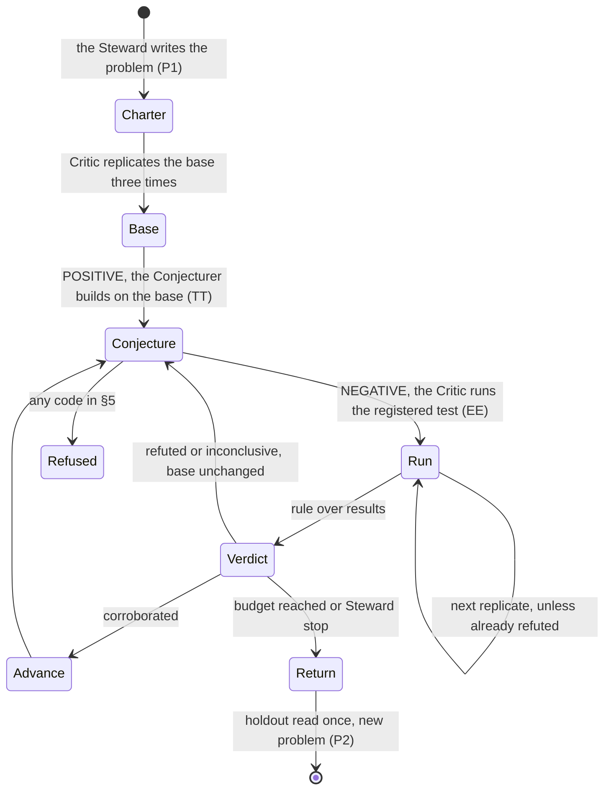

# `follow-research-contract` — the popper contract

`type: resource.contract` · normative. Every other file is subordinate to this one.

popper researches at the edge between two worlds. In the theory world a machine conjectures; in the data world a frozen evaluator reports a number. The only thing that crosses the edge is a **verdict**: an observed result read against a prediction that was fixed before the result existed. This is Popper's asymmetry made into a law (no number of passing runs proves a conjecture, one failing run refutes it), and a pair of feedback loops in the cybernetic sense made into a file format: a positive loop that amplifies what has survived, and a negative loop that removes what has not.

## Specification

```json { type: notebook.cell }
{
  "id": "docs/follow-research-contract.md",
  "type": "resource.contract",
  "role": "define the two worlds, the edge, the trace, flow laws, refusals and predicates",
  "reads": ["DISCLAIMER", "research.json", "ooc/popper.og"],
  "writes": [],
  "must": ["every advance passes through the data", "predict before running", "the Critic alone runs and judges", "only the Steward charters", "corroborated is never true", "the holdout is read once", "append only", "match codes, not prose"],
  "check": ["R1-R20"]
}
```

## Graph

- ← [read-repository.md](read-repository.md)
- → [pin-sources.md](pin-sources.md)
- → [vary-cybernetics.md](vary-cybernetics.md)
- → [frame-writing-engine.md](frame-writing-engine.md)
- → [../skills/conjecture-hypothesis.md](../skills/conjecture-hypothesis.md)
- → [../skills/refute-experiment.md](../skills/refute-experiment.md)
- → [../skills/check-netlist.md](../skills/check-netlist.md)
- → [../systems/loop-research.md](../systems/loop-research.md)

## Composition

```toml { type: notebook.cell }
config = "research.json"                 # source pin, testbed, data, critic rule, charter defaults
index = "ooc/popper.og"                  # optional local file map
skills = ["skills/write-conjecture.md", "skills/conjecture-hypothesis.md", "skills/refute-experiment.md", "skills/prove-rule.md", "skills/check-netlist.md"]
prover = "research.json prover"             # Lean 4 toolchain pin; the kernel checks the rule before the base runs
library = "research.json library"           # Cello-style host constraints; the Checker closes unrealizable options before seq 1
checker = "research.json checker"           # margin, score and the netlist projection of a trace
design = "docs/frame-design-rules.md"       # Cello's design automation indexed by generality; pinned in research.json design
engine = "research.json engine"             # tulip's writing engine: lexicons and offsets that generate every diff
framework = "docs/frame-writing-engine.md"  # tulip's metaheuristics indexed by generality; pinned in research.json framework
system = "systems/loop-research.md"      # LOOP(data) { POSITIVE hypothesis; NEGATIVE experiments; } RETURN
swarm = "systems/swarm-research.md"      # many lanes of the system in parallel, one ledger, AUC objective
variant = "docs/vary-cybernetics.md"     # feedback and principles of refutation
store = "one trace per charter"          # JSON Lines, append only, root-chained (§3)
```

## Indications

- A kept change must be explainable by a prediction that could have failed and did not.
- A Steward wants to leave an autoresearch-style loop running unattended and read back, in the morning, which ideas were refuted, which survived, and whether the survivors hold on data the loop never saw.
- A reviewer must tell a corroborated result from a lucky one.

## Contraindications

- Not a hill climber. A change is never kept because one run came out lower (§4.3, `self_verdict`).
- Not a verifier. Nothing in popper is ever called true, proven, confirmed or verified (`verification`). The Prover checks theorems about the rule in Lean 4, never about a conjecture or a result; a passing check is "checked by Lean" (`skills/prove-rule.md`).
- Not a circuit compiler. The Checker closes an option the pinned device cannot run and reports how narrow each advance was; it never proposes, keeps or discards anything (`self_verdict`, `skills/check-netlist.md`).
- Not a closed loop without a check. The base never advances twice without a corroborated verdict between (§4.1, `closed_loop`).
- Not a way to move the goalposts. The evaluator, the data split, the seed protocol and the decision rule are fixed by the charter and the pins; a conjecture may not touch them (`drift`, `confound`, `ad_hoc`).
- Not unattended forever. The source's loop never stops; popper's loop returns at the charter's budget or when the Steward stops it (§4.9).

## §0 Roles and IDs

| Role | World | Does | Never |
|---|---|---|---|
| **Steward** | human | writes the charter: the problem, the testbed, `delta_min`, the budget; may stop or amend | conjectures, runs, judges, reads the holdout before RETURN |
| **Conjecturer** | theory (positive) | picks one option at each Engine hinge, then states the claim and the prediction for the diff it picked; reads the whole trace (Type II) | writes diff bytes, runs, judges, edits a registered prediction, touches a frozen file |
| **Engine** | machine | offers a hinge of generated diffs on the base, derives the key from the Conjecturer's pick, writes the diff (tulip's writing engine, `skills/write-conjecture.md`) | chooses, samples, writes a diff no key explains |
| **Critic** | data (negative) | runs the registered test exactly: seeds, replicates, rule; emits the verdict (Type I) | reads the rationale, chooses which runs count, reruns a refuted arm |
| **Recorder** | frame | writes notebook entries to the Steward from the trace | invents an event, calls a conjecture true |
| **Prover** | formal | has the pinned Lean 4 kernel check the rule's theorems before the base runs (`skills/prove-rule.md`) | states a theorem about a conjecture or a measured result, writes a trace event, admits `sorry` or a new axiom |
| **Checker** | formal | closes options `research.json` `library` forbids before seq 1, checks that levels propagate across advances, reports margins, the score and the netlist (`skills/check-netlist.md`) | judges, keeps or discards, writes a trace event, adds a rule no result evidences |

The roles are defined in `skills/write-conjecture.md`, `skills/conjecture-hypothesis.md`, `skills/refute-experiment.md`, `skills/prove-rule.md`, `skills/check-netlist.md` and `systems/loop-research.md`. Their read and write boundaries apply even if a single runner performs them. Only the human Steward writes, amends or stops a charter (`self_charter`). The pinned `prepare.py` supplies the evaluator, `evaluate_bpb`.

The code blocks marked `notebook.cell` are examples or declarations in ordinary Markdown; the mark has no execution semantics. The optional `ooc/popper.og` index uses `::name` and `::end` to delimit sections; its typed nodes and arrows index local files or node IDs. Its checksum is the SHA-256 of the file bytes with the entire `checksum:` line removed.

```text { type: notebook.cell }
testbed := ^testbed:[a-z0-9-]{2,32}$          # research.json testbed.id
kind    := improves | simplifies
verdict := corroborated | refuted | inconclusive
seq     := ^[1-9][0-9]*$                       # position of an event in its trace
```

## §1 Objects

```text { type: notebook.cell }
Charter    = { problem: String, testbed, delta_min: Number, max_tested: Integer, holdout_delta: Number, tag: String }
Prediction = { kind, delta: Number, forbids: String }        # fixed before any run of its arm
Hinge      = { skill, offered: [Option] | Domain }           # the Engine's options on the base
Choice     = { picked: String, bits: Number }                # the Conjecturer's pick; bits = log2(distinct diffs offered)
Key        = { skill, ...params, clamped?: Boolean, seed: "conjecturer" | "machine" }
Constraint = { skill, lexicon: String, key: seq }
Conjecture = { claim: String, diff: Patch, base: commit, prediction: Prediction, constraint: Constraint, rescues?: seq }   # diff = engine(constraint, key)
Arm        = { commit, seeds: [Integer; 3] }                 # the code under test and its derived seeds
Run        = { arm: seq, i: 1..3, seed: Integer, commit, holdout?: true }
Result     = { run: seq, val_bpb?: Number | null, memory_gb: Number, status: "ok" | "crash" | "timeout", reason?: String }
Verdict    = { conjecture: seq, verdict, h: [Number], b: [Number], bits: 0 | 1, holdout?: true }
Advance    = { from: commit, to: commit }                    # the base moves; only after corroborated
Return     = { tested, refuted, corroborated, inconclusive, edge, holdout: verdict | "not_run", base: commit, P2: String }
Event      = { seq, world: "human" | "machine" | "theory" | "data" | "frame", kind, body, cites: [seq] }
Trace      = [Event]                                         # append only
Notebook   = notes(Trace)                                    # what the Steward reads
```

| `world` | `kind` | `body` | `cites` |
|---|---|---|---|
| `human` | `charter`, `amend`, `stop` | `Charter`, or a reason | the charter it amends or stops |
| `machine` | `hinge` | `Hinge` | the charter or verdict that set the base |
| `theory` | `choice` | `Choice` | its hinge |
| `machine` | `key` | `Key` | its choice, or its hinge for a machine pick |
| `theory` | `conjecture` | `Conjecture` | the base's verdict, any refuted conjecture it learns from, and its key |
| `data` | `run` | `Run` | the conjecture (or charter, for the base; or the event that ended the probe loop, for the holdout) it tests |
| `data` | `result` | `Result` | its run |
| `data` | `verdict` | `Verdict` | the conjecture and every base and arm result used; for the holdout, also the final advance |
| `data` | `advance` | `Advance` | a corroborated verdict |
| `frame` | `note` | prose to the Steward, §6 | every event it reports |
| `frame` | `return` | §4.8 | every verdict |

Each trace stores one UTF-8 JSON object per line, with `seq` starting at 1 and citations pointing to earlier events in the same trace. A `commit` is a full Git commit ID, and a `Patch` is a unified diff. The Steward starts with `research.json` `charter` defaults or sets explicit values: positive finite thresholds, a positive integer test budget, and a tag that forms a valid Git branch name under `popper/`. An `amend` supplies a replacement charter, keeping the testbed and tag fixed; a `stop` supplies a reason. For a holdout run, `i` ranges from 1 to 6 and `arm` is the event that triggered RETURN.

## §2 Two worlds and the edge

- The **edge** is the set of `verdict` events. It is precise: each verdict carries at most one bit.
- `bits(verdict) = 1` when the registered prediction forbids some outcomes of the test and allows others. For `simplifies`, the line count is part of the test. A prediction that forbids nothing ("may change val_bpb") or everything is refused before it runs (`unfalsifiable`).
- An `inconclusive` verdict (a crash or a timeout) carries 0 bits. It is not a refutation; it is an experiment that did not happen.
- `edge(trace) = Σ bits(verdict)` over probe verdicts: how much the data has told the loop. Refutations count exactly as much as corroborations. The holdout does not feed back into the loop.
- A **choice** crosses a second, inner edge, from theory to machine, as in tulip. `bits(choice) = log2(distinct diffs offered)`. Two options that write the same diff count as one, so a choice between them carries 0 bits. Choice bits measure how much of a diff the Conjecturer chose. Verdict bits measure how much the data said. The two are reported separately and never added.
- A corroborated conjecture is **not** shown true. It is the best-tested conjecture so far, and every later test may still refute it (`docs/vary-cybernetics.md` P5).

## §3 Algebra

```text { type: notebook.cell }
hex(x)      = 64 lowercase hex characters of a SHA-256 digest
ehash(e)    = hex(sha256(JCS(e)))                      # RFC 8785 JCS
root(empty) = hex(sha256("popper/1"))                  # research.json loop.root_empty
root(w · e) = hex(sha256(root(w) || ehash(e)))         # || joins two hex strings, hashed as UTF-8
seed(r, i)  = int(hex(sha256(r || "seed/" || i))[0:8], 16)   # r = root just after the event that registers the arm
```

- **Monoid.** Traces compose by concatenation; the empty trace is the identity.
- **Registration by chaining.** A prediction is registered when its `conjecture` event is in the chain. Any later edit changes every later root (`broken_chain`), so a prediction cannot be changed after a result without detection.
- **Seed derivation.** The Critic derives seeds from the root after registration rather than choosing them; replay derives the same seeds. Encode the replicate index as decimal text without padding.
- **Determinism of the rule.** `verdict` is a pure function of the prediction, the base results and the arm results. Replaying the results of a trace gives the same verdicts and the same root.
- **Single-comparison bound.** For `improves`, under exchangeability and with no ties, the chance that all three arm values fall below all three base values is `1 / C(6,3) = 1/20 = 0.05`. The gain threshold can only tighten that criterion. This is not a calibrated error rate for the adaptive loop.

## §4 Flow laws



1. **Every advance passes through the data.** Between two `advance` events there is a `verdict: corroborated` that the second advance cites. A base that moves for any other reason is refused (`closed_loop`).
2. **Predict before running.** A `run` of an arm cites a `conjecture` event earlier in the chain. A run with no registered prediction (`unregistered`), or a prediction event after its first run (`post_hoc`), is refused.
3. **Only the rule judges.** `verdict` is computed by `skills/refute-experiment.md` from `research.json` `critic.test`. "Looks promising", "probably noise", "close enough" are not verdicts (`self_verdict`).
4. **The Critic is reactive.** It reads the diff, the kind, `delta`, the base results and its own run results. It never reads the claim's rationale, the notebook or the Conjecturer's earlier ideas (`stateful`).
5. **The testbed is fixed.** A diff touches only `research.json` `testbed.edit`, adds no dependency, and leaves the frozen files' bytes equal to their pins (`out_of_scope`, `drift`). It never touches the seed lines, the time budget or the evaluation (`confound`).
6. **No rescue.** A refuted diff is never run again under a weaker prediction, and the rule is never changed to save it. A revision is a new conjecture with a different diff that cites the refutation (`ad_hoc`).
7. **Append only.** Nothing in a trace is edited or removed. A refuted conjecture stays in the trace forever, and its diff stays recoverable from the event. A wrong note gets a new note that says so.
8. **The Engine writes every diff.** A conjecture's `diff` is `engine(constraint, key)` byte for byte, and its key derives from a `choice` among the options offered at that base's hinge. Under a declared `seed: "machine"` there is no `choice` event: the key cites the hinge directly and records `picked`, with 0 Conjecturer bits. The Conjecturer picks an option and never writes diff bytes (`not_offered`). A diff that no key explains is `pure_chance`. A refuted diff is never offered again (`ad_hoc`). The pinned procedures never delete a line, so their conjectures are `improves`.
9. **The loop returns.** It stops when `charter.max_tested` conjectures have verdicts, when the Steward emits `stop`, or when the Engine emits a hinge with no options (every diff it can write on the base has been refuted). An empty hinge has no choice after it and is what ends the probe loop. If the base changed, the Critic opens one holdout comparison between first and last base at RETURN (`peek` on any other access). The Recorder emits `Return`, with probe counts and probe edge only, the separate holdout verdict or `not_run`, and the new problem.

## §5 Refusal codes

Refusals use codes, not message text. Use the first failing code in table order.

| Code | When |
|---|---|
| `unpinned` | the source, a data shard or the holdout harness has no pin in `research.json` |
| `drift` | pinned bytes do not hash to `digest`, or a replay gives different verdicts |
| `unproved` | the `skills/prove-rule.md` cell is empty or misses a theorem, fails under the pinned Lean, uses a forbidden token, or depends on an axiom outside `research.json` `prover.axioms`, or `research.json` `critic` or `engine` changed without the matching cell change |
| `unrealizable` | a charter offers an option, or a library rule closes one, against `research.json` `library` on the pinned device |
| `self_charter` | a `charter`, `amend` or `stop` event came from anyone but the Steward |
| `out_of_scope` | a diff touches a file outside `testbed.edit`, or adds a dependency |
| `confound` | a diff touches the seed lines, `TIME_BUDGET`, `MAX_SEQ_LEN`, `EVAL_TOKENS` or the evaluation call |
| `bad_key` | a key is outside its skill's space, writes an empty diff, or names a lexicon that lacks the base value |
| `ragged` | a `combine-lines` row lacks a column |
| `not_offered` | `picked` is not an option at its hinge, or the Conjecturer wrote diff bytes |
| `pure_chance` | a diff differs from `engine(constraint, key)`, or a selection is not explained by a choice, the rule or a declared machine seed |
| `unfalsifiable` | a prediction has no `kind`, a `delta` below `charter.delta_min`, or forbids no outcome or all outcomes (§2) |
| `ad_hoc` | a conjecture reuses the bytes of a refuted diff, or a rule or charter changes to save a refuted conjecture |
| `unregistered` | a `run` cites no earlier `conjecture` (or the charter for the base; or the `stop`, the empty `hinge` or the last probe verdict that ended the probe loop, for the holdout) |
| `post_hoc` | a prediction is first recorded, or changed, after a `result` of its arm |
| `stateful` | a verdict depends on anything but the prediction, the base results and the arm results |
| `self_verdict` | a verdict that the rule in `research.json` `critic.test` does not give, or a keep or discard with no verdict |
| `mismatch` | after an advance, the next probe verdict's base results are not the advanced arm's own results |
| `closed_loop` | an `advance` that cites no corroborated verdict, or two advances with one verdict between them |
| `peek` | the holdout shard is read before RETURN, read twice, or read by the Conjecturer |
| `verification` | a note or return calls a conjecture true, proven, confirmed or verified, or calls a refutation a failure of the loop |
| `invention` | a note states as fact something no cited event records |
| `broken_chain` | a trace root does not follow §3 |

## §6 Notebook grammar

The Recorder writes to the Steward. A note is second person, present tense, at most 200 words, and follows every probe verdict. The holdout is reported in `return`.

- It says what was conjectured [conjecture e], what the conjecture forbade, what the data returned [result e], and which way the rule went [verdict e], and whether the base moved [advance e].
- It names a refutation as knowledge: what is now ruled out.
- It names a corroboration as survival: what the conjecture risked, and that it may still fall.
- It cites an event inline as `[e<seq>]` and a pin as `[pin:<id>]`.
- It may say what the next conjecture could try only with "perhaps" or in the conditional.
- Forbidden words about a conjecture: *true*, *proven*, *confirmed*, *verified*, *works* as a statement of fact (`verification`).

## §7 Predicates

| ID | Holds when |
|---|---|
| R1 | the source, the shards and the holdout harness are pinned and hash to their digests |
| R2 | the charter and every amend or stop came from the Steward |
| R3 | every diff stays inside `testbed.edit` and leaves frozen files, seed lines and evaluation untouched |
| R4 | every prediction is falsifiable (§2) with `delta ≥ charter.delta_min` |
| R5 | every run cites its earlier registration event: the conjecture, the charter for the base, or the `stop`, the empty `hinge` or the last probe verdict that ended the probe loop, for the holdout |
| R6 | every run's seed equals `seed(r, i)` for its arm (§3) |
| R7 | every verdict is the rule's output on its cited results, and an `improves` arm stops at its first refuting replicate |
| R8 | every advance cites exactly one corroborated verdict not cited by an earlier advance |
| R9 | no refuted diff is rerun, and no rule changes between a refutation and the next verdict |
| R10 | the holdout is opened only by the Critic, for one comparison at RETURN if the base changed |
| R11 | every factual statement in a note cites an event, and no note uses a forbidden word (§6) |
| R12 | the trace root follows §3 |
| R13 | projecting the trace to `results.tsv` (`research.json` `loop.status_map`) gives one row per arm run under test |
| R14 | every conjecture's diff equals `engine(constraint, key)`, and its key cites a choice of an offered option, or, with `seed: "machine"`, its hinge |
| R15 | every `choice.bits` equals `log2` of the distinct diffs offered at its hinge, and no refuted diff is offered |
| R16 | every `key` with `seed: "machine"` is declared by the charter and carries 0 Conjecturer bits |
| R17 | the `skills/prove-rule.md` cell checks under `research.json` `prover` before the first base run, with no forbidden token and only the pinned axioms |
| R18 | after every advance, the next probe verdict's base results are exactly the advanced arm's results |
| R19 | every option the charter can offer is realizable under `research.json` `library`, and every library rule cites the result that evidences it |
| R20 | projecting the trace to a netlist (`research.json` `checker.netlist`) gives one interaction per verdict, refuted and inconclusive included, from which every margin and the night's score recompute |

## Citations

| Pin | Supports |
|---|---|
| [autoresearch `228791f`](https://github.com/karpathy/autoresearch/tree/228791fb499afffb54b46200aca536f79142f117) | the testbed, the loop being forked (`docs/pin-sources.md`) |
| [tulip `a2b9560`](https://github.com/wetware-hq/tulip/tree/a2b956086f97d547f267efa47f3efabbd48995d6) | the writing engine: Reader and Engine, hinge, key, bits of choice, S+n, line matrix, branching tale |
| [Variety (Ashby)](https://en.wikipedia.org/wiki/Variety_(cybernetics)) | a night's diffs are bounded by its choices plus the rule |
| [Popper, *The Logic of Scientific Discovery* (1959)](https://en.wikipedia.org/wiki/The_Logic_of_Scientific_Discovery) | falsifiability, demarcation, corroboration, no ad hoc rescue |
| [Popper, *Conjectures and Refutations* (1963)](https://en.wikipedia.org/wiki/Conjectures_and_Refutations) | the loop's two halves |
| [Popper, *Objective Knowledge* (1972)](https://en.wikipedia.org/wiki/Objective_Knowledge) | P1 → TT → EE → P2 |
| [Falsifiability](https://en.wikipedia.org/wiki/Falsifiability) | demarcation of testable claims |
| [Maruyama, *The Second Cybernetics* (1963)](https://en.wikipedia.org/wiki/Magoroh_Maruyama) | deviation-amplifying (positive) feedback |
| [Cybernetics (Wiener, 1948)](https://en.wikipedia.org/wiki/Cybernetics:_Or_Control_and_Communication_in_the_Animal_and_the_Machine) | deviation-counteracting (negative) feedback |
| [Permutation test](https://en.wikipedia.org/wiki/Permutation_test) | the 1/20 bound in §3 |
| [RFC 8785](https://www.rfc-editor.org/rfc/rfc8785) | JCS for `ehash` |
| [Lean 4 `v4.36.0` `611c117`](https://github.com/leanprover/lean4/commit/611c117bfaf7b7ae1cfcf246ce6fba31e8f509e9), [docs](https://lean-lang.org/doc) | the Prover's kernel (`skills/prove-rule.md`, R17) |
| [Cello at `1164404`](https://github.com/CIDARLAB/cello/tree/11644045e5ab677965a8e5765db2fb8535484a53) | host constraints, the input-level check and the circuit score (`research.json` `library`, R18–R19) |
| [SBOL 2.3](https://sbolstandard.org/datafiles/SBOL2.3.0.pdf) | the netlist projection's object names (`research.json` `checker.netlist`, R20) |

## Falsification

Actively try to break the loop. Each row must fail with its code.

| Challenge | Failure signal |
|---|---|
| Let the Conjecturer raise `delta_min` after a run of near misses | `self_charter` |
| Let the Conjecturer write `MATRIX_LR = 0.045` itself | `not_offered` |
| Edit `evaluate_bpb` so the metric reads lower | `drift` |
| Change `torch.manual_seed(42)` inside the conjecture's diff | `confound` |
| Register "this may affect val_bpb" | `unfalsifiable` |
| Rerun a refuted `MATRIX_LR = 0.05` with `delta` lowered from 0.002 to 0.001 | `ad_hoc` |
| Run first, write the prediction from the result | `post_hoc` |
| Keep a change because its one run came out lower than the base's best | `self_verdict` |
| Evaluate on shard 06541 halfway through the night | `peek` |
| Charter `DEPTH 10` beside `DEVICE_BATCH_SIZE 128` on the pinned device | `unrealizable` |
| Re-run the base after an advance so the next arm is judged against fresh base levels | `mismatch` |
| Note says "depth 9 is the better model" | `verification` |
| Delete a refuted conjecture from the trace | `broken_chain` |
| Start the base runs with a `sorry` in the Prover cell | `unproved` |

## Licence

MIT, see `LICENSE`.
