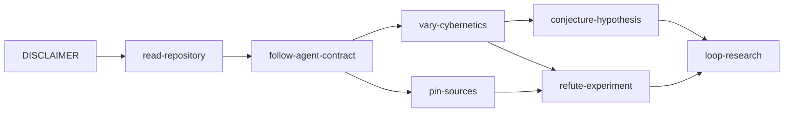

# `read-repository` — route an agent

`type: resource.router` · `spec: agent.router` · non-normative; `docs/follow-agent-contract.md` governs on any conflict.

popper is a cybernetic auto-research engine. It is a specbase: an agent reads these files at run time and runs a research loop in which a Conjecturer proposes, a Critic tries to refute, and only the data decides. There is no app and no server; the testbed it drives is pinned in `research.json`.

## Specification

```json { type: notebook.cell }
{
  "id": "docs/read-repository.md",
  "type": "resource.router",
  "role": "send each task down the smallest sufficient path",
  "reads": ["DISCLAIMER", "task"],
  "writes": [],
  "must": ["read DISCLAIMER first", "load the contract before any skill", "stop at the first sufficient row"],
  "check": ["route row exists", "Graph reciprocity"]
}
```

## Graph

- → [follow-agent-contract.md](follow-agent-contract.md)
- → [vary-cybernetics.md](vary-cybernetics.md)
- → [../systems/loop-research.md](../systems/loop-research.md)

## Route

Read `DISCLAIMER` before any node. Then take the first row that covers the task and stop.

| Task | Path |
|---|---|
| Run a whole research night under a Steward's charter | contract → `systems/loop-research.md` |
| Propose the next hypothesis | contract → `skills/conjecture-hypothesis.md` |
| Test a registered hypothesis and give its verdict | contract → `skills/refute-experiment.md` |
| Understand what popper changes from tulip or from autoresearch | `docs/vary-cybernetics.md` |
| Check whether a source, shard or harness may be used | `docs/pin-sources.md` |
| Audit or replay a finished trace | contract §7 → `systems/loop-research.md` §Replay |
| Traverse without reading prose | `ooc/popper.og` |
| Anything else, or a conflict | `docs/follow-agent-contract.md` |

## Reading order



## Licence

MIT, see `LICENSE`. Sources are cited and pinned, not vendored.
