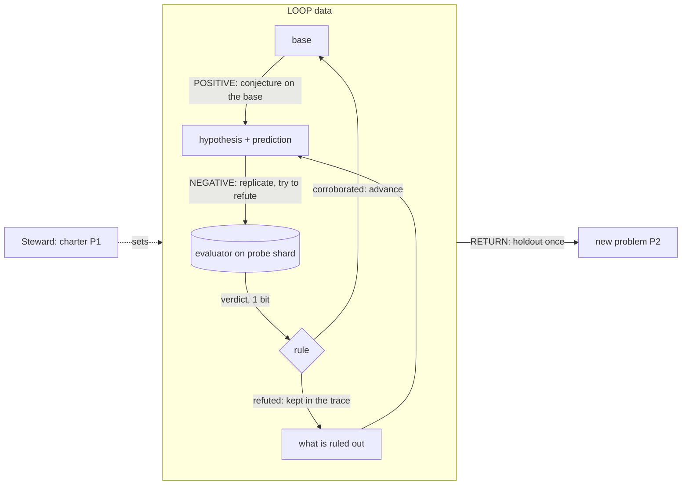

# `vary-cybernetics` — what popper changes, and the rules of refutation

`type: resource.reference` · subordinate to `docs/follow-research-contract.md`, which governs on any conflict.

popper varies the research loop of [autoresearch](https://github.com/karpathy/autoresearch/tree/228791fb499afffb54b46200aca536f79142f117). It does not keep whatever came out lower. Each advance passes through a test fixed before the run, and only what the data fails to refute becomes the base.

```text { type: notebook.cell }
VARY<CYBERNETICS>
LOOP(data) {
  POSITIVE hypothesis;     # deviation-amplifying: build on what survived (Maruyama)
  NEGATIVE experiments;    # deviation-counteracting: remove what did not (Wiener)
} RETURN P2               # P1 → TT → EE → P2 (Popper)
```

## Specification

```json { type: notebook.cell }
{
  "id": "docs/vary-cybernetics.md",
  "type": "resource.reference",
  "role": "define the feedback loops and the principles of refutation",
  "reads": ["docs/follow-research-contract.md", "research.json"],
  "writes": [],
  "must": ["demarcation", "pre-registration", "asymmetry", "no ad hoc rescue", "corroboration is not truth", "severity on unseen data", "refutation is knowledge"],
  "check": ["R4", "R5", "R7", "R9", "R10", "R11"]
}
```

## Graph

- ← [follow-research-contract.md](follow-research-contract.md)
- → [../skills/conjecture-hypothesis.md](../skills/conjecture-hypothesis.md)
- → [../skills/refute-experiment.md](../skills/refute-experiment.md)

## Two loops



- **Positive feedback.** Each corroborated conjecture becomes the base the next one builds on, so a small surviving deviation is amplified. Unchecked, this is a ratchet: in the source, a change is kept when one run beats the current best, and the best is then a lucky low that the next run must beat. Positive feedback on noise climbs on noise.
- **Negative feedback.** The Critic rejects a change that fails its registered rule. For an improvement, one run at or above the base's minimum ends the test immediately.
- **Second order.** The Steward sets the charter, outside both feedback loops. The Steward may amend or stop the loop, but does not propose or judge experiments.
- **Memory.** Type I is reactive: the Critic uses only the registered test, base results and current run results to decide. Type II uses a record of past experience: the Conjecturer reads the trace, including the refuted diffs, to choose what to try next.

## What popper patches in the source loop

`program.md` at the pin is a deliberately bare baseline. These are the places where its keep-or-discard rule is a verification rule, not a refutation rule, and what popper does instead.

| `program.md` at `228791f` | Problem | popper |
|---|---|---|
| A single lower `val_bpb` advances the branch | One run cannot tell an effect from run-to-run variation, and the source never measures that variation | Three replicates per arm, all below the best base run, with a mean gain of at least `delta` (`skills/refute-experiment.md`) |
| The idea lives in the commit and the TSV description, written around the run | The prediction is not fixed before the result | A `conjecture` event with `kind`, `delta` and `forbids` is chained before the first run (`unregistered`, `post_hoc`) |
| Every decision reads the same pinned val shard (`shard_06542`), about a hundred times a night | The loop selects on its own test set | A sealed holdout (`shard_06541`), read once, at RETURN (`peek`) |
| An equal or worse result resets the branch | The rejected diff is not kept in the results table | The trace is append only; a refuted diff stays in its event |
| `torch.manual_seed(42)` in editable `train.py` | Every run measures one seed, and a diff can change it | Seeds come from the trace root; the diff may not touch them (`confound`) |
| A crash: fix and re-run, or log `crash` | — | Kept: a crash is `inconclusive`, 0 bits, never a refutation |
| Simpler changes are preferred when all else is equal | — | Kept as its own kind, `simplifies`: a net deletion that must not cost more than `delta_min` |
| The loop has no stop condition | No return value | `LOOP(data) … RETURN` at the charter's budget, with P2 |

The simplicity criterion is already Popperian: a simpler theory forbids more and is easier to refute, so it is preferred before any test.

## Principles

Each principle is a rule over trace events (contract §1).

| ID | Principle | Rule | Refusal |
|---|---|---|---|
| P1 | **Demarcation.** A conjecture is research only if some result would refute it. | Every conjecture has `kind` and `delta ≥ charter.delta_min`, and its `forbids` names the results it rules out. | `unfalsifiable` |
| P2 | **Pre-registration.** The prediction comes before the data. | The `conjecture` event is in the chain before the first `run` of its arm and never changes. | `unregistered`, `post_hoc` |
| P3 | **Asymmetry.** One counter-instance refutes; no number of instances proves. | An `improves` arm is refuted at the first replicate at or above the base's minimum; corroboration needs all three below it. | `self_verdict` |
| P4 | **No ad hoc rescue.** A refuted conjecture is not saved by weakening it or by changing the test. | A refuted diff's bytes are never run again; the rule and the charter do not change to save it. | `ad_hoc`, `self_charter` |
| P5 | **Corroboration is not truth.** What survives is the best-tested so far. | No note or return calls a conjecture true, proven, confirmed or verified. | `verification` |
| P6 | **Severity.** A test counts most on data the conjecture could not have been chosen to fit. | If the base changed, the holdout is opened in one comparison at RETURN. | `peek` |
| P7 | **Error is knowledge.** We learn from what is refuted. | Every refutation stays in the trace; the Conjecturer reads them all (Type II), and a revision cites what it learns from. | `broken_chain` |

### Consequences the Recorder must state

- **Refutation is cheap, corroboration is not.** A false idea usually costs one run; a surviving one costs three. If most ideas fail, the loop runs at close to the source's speed (about twelve tests an hour on its hardware), and pays more only for what it keeps.
- **The base is biased low.** A corroborated arm's three results passed a filter, so they are likely lower than that code's average. That makes the next test stricter, not looser: the bias works against the positive loop.
- **One test is not a night.** The 1/20 calculation concerns one comparison of six exchangeable outcomes, not an adaptive sequence on the same shard. Report the corroboration count next to the number of tests, and report the holdout separately.

## Citations

| Pin | Supports |
|---|---|
| [Hintze, *Understanding the four types of AI*](https://theconversation.com/understanding-the-four-types-of-ai-from-reactive-robots-to-self-aware-beings-67616) | Type I and Type II |
| [autoresearch `program.md` at `228791f`](https://github.com/karpathy/autoresearch/blob/228791fb499afffb54b46200aca536f79142f117/program.md) | the loop being patched |
| [Popper, *The Logic of Scientific Discovery*](https://en.wikipedia.org/wiki/The_Logic_of_Scientific_Discovery) | P1, P3, P4, P5; simplicity as falsifiability |
| [Popper, *Objective Knowledge*](https://en.wikipedia.org/wiki/Objective_Knowledge) | P1 → TT → EE → P2; P7 |
| [Falsifiability](https://en.wikipedia.org/wiki/Falsifiability) | demarcation |
| [Maruyama](https://en.wikipedia.org/wiki/Magoroh_Maruyama) | deviation-amplifying feedback |
| [Second-order cybernetics](https://en.wikipedia.org/wiki/Second-order_cybernetics) | the Steward outside the loop |
| [Multiple comparisons problem](https://en.wikipedia.org/wiki/Multiple_comparisons_problem) | one in twenty by luck |

## Falsification

| Challenge | Failure signal |
|---|---|
| Keep a change whose first replicate is above the base's minimum "because the mean is lower" | `self_verdict` (P3) |
| After a refutation, rerun the same diff with hand-picked seeds | `confound`, `ad_hoc` (P4) |
| Note says the loop "proved" a schedule | `verification` (P5) |
| Read the holdout after every advance | `peek` (P6) |
| Drop refuted rows from `results.tsv` and the trace | `broken_chain` (P7) |

## Licence

MIT, see `LICENSE`.
