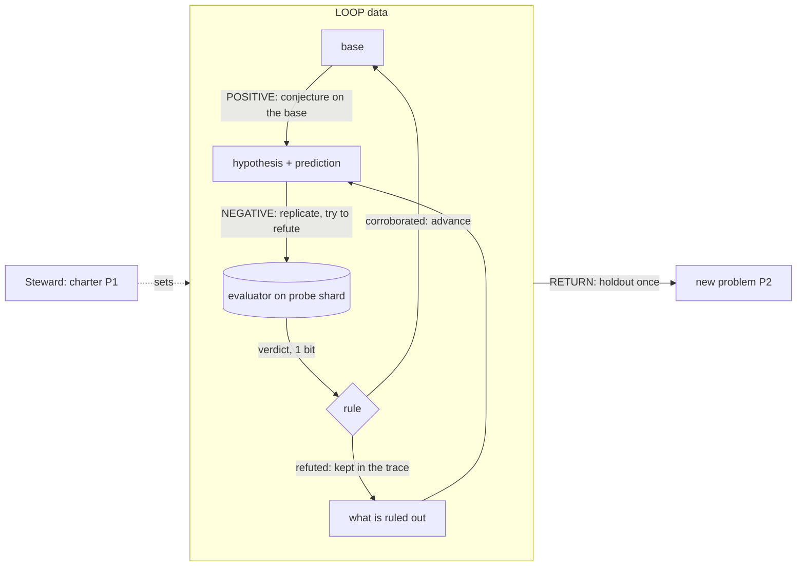

# `vary-cybernetics` — what popper changes, and the rules of refutation

`type: resource.reference` · `spec: agent.reference` · subordinate to `docs/follow-agent-contract.md`, which governs on any conflict.

popper is a variant. It takes the cybernetic frame of [tulip](https://github.com/wetware-hq/tulip/tree/a2b956086f97d547f267efa47f3efabbd48995d6) and the research loop of [autoresearch](https://github.com/karpathy/autoresearch/tree/228791fb499afffb54b46200aca536f79142f117), and varies one thing in each: the loop no longer has to pass through a person, and it no longer keeps whatever came out lower. It has to pass through the data, and it keeps only what the data failed to refute.

```text { type: notebook.cell }
VARY<CYBERNETICS>
LOOP(data) {
  POSITIVE hypothesis;     # deviation-amplifying: build on what survived (Maruyama)
  NEGATIVE experiments;    # deviation-counteracting: remove what did not (Wiener)
} RETURN wetware-hq/popper # P1 → TT → EE → P2 (Popper)
```

## Specification

```json { type: notebook.cell }
{
  "id": "docs/vary-cybernetics.md",
  "type": "resource.reference",
  "role": "state the variation from tulip and from autoresearch, and the rules of refutation as checkable principles",
  "reads": ["tulip contract at a2b9560", "autoresearch program.md at 228791f"],
  "writes": [],
  "must": ["demarcation", "pre-registration", "asymmetry", "no ad hoc rescue", "corroboration is not truth", "severity on unseen data", "refutation is knowledge"],
  "check": ["R4", "R5", "R7", "R9", "R10", "R11"]
}
```

## Graph

- ← [follow-agent-contract.md](follow-agent-contract.md)
- → [../skills/conjecture-hypothesis.md](../skills/conjecture-hypothesis.md)
- → [../skills/refute-experiment.md](../skills/refute-experiment.md)

## Two loops



- **Positive feedback.** Each corroborated conjecture becomes the base the next one builds on, so a small surviving deviation is amplified. Unchecked, this is a ratchet: in the source, a change is kept when one run beats the current best, and the best is then a lucky low that the next run must beat. Positive feedback on noise climbs on noise.
- **Negative feedback.** Each conjecture is run against a rule that tries to remove it. One replicate that fails the prediction removes it at once. This is what keeps the positive loop on the signal.
- **Second order.** The Steward is outside both loops. tulip's Reader chose at every fork; popper's Steward chooses once, the rules by which the loop may be wrong, and then may sleep. This is the observer who sets the regulator, rather than the regulator.

## The variation, axis by axis

| Axis | tulip | popper |
|---|---|---|
| What every loop must pass through | the Reader's choice (`closed_loop`) | the data's verdict (`closed_loop`) |
| Where the human is | inside the loop, at every hinge | outside it: the charter, `stop`, `amend` |
| May the machine choose? | never (Engine); a Reader-written table (Autopilot) | the Conjecturer chooses what to try, freely; never what holds |
| Feedback | negative only | positive (conjecture on the base) and negative (refutation) |
| Memory | Type I only; memory is `stateful` | Conjecturer is Type II and must learn from refutations; the Critic stays Type I |
| Unit at the edge | bits of choice | one bit per verdict that could have gone either way |
| The illusory option | a fork whose two ways meet (0 bits) | a test that cannot fail (0 bits, `unfalsifiable`) |
| Declared clinamen | a machine-seeded key | the Critic's seeds, derived from the trace root |
| Who may write prose | the Narrator, from the trace | the Recorder, from the trace; never "true" |
| When it stops | a terminal, ten incipits, or the Reader | the charter's budget, or the Steward; then the holdout, once |

## What popper patches in the source loop

`program.md` at the pin is a deliberately bare baseline. These are the places where its keep-or-discard rule is a verification rule, not a refutation rule, and what popper does instead.

| `program.md` at `228791f` | Problem | popper |
|---|---|---|
| "If val_bpb improved (lower), you advance the branch" on one run | One run cannot tell an effect from run-to-run variation, and the source never measures that variation | Three replicates per arm, exact dominance test at 1/20, effect at least `delta` (`skills/refute-experiment.md`) |
| The idea lives in the commit and the TSV description, written around the run | The prediction is not fixed before the result | A `conjecture` event with `kind`, `delta` and `forbids` is chained before the first run (`unregistered`, `post_hoc`) |
| Every decision reads the same pinned val shard (`shard_06542`), about a hundred times a night | The loop selects on its own test set | A sealed holdout (`shard_06541`), read once, at RETURN (`peek`) |
| "If val_bpb is equal or worse, you git reset"; `results.tsv` is untracked | Refutations are thrown away | The trace is append only; a refuted diff stays in its event |
| `torch.manual_seed(42)` in `train.py`, which the agent edits | Every run measures one seed, and a diff can change it | Seeds come from the trace root; the diff may not touch them (`confound`) |
| A crash: fix and re-run, or log `crash` | — | Kept: a crash is `inconclusive`, 0 bits, never a refutation |
| "Simplicity criterion: all else being equal, simpler is better" | — | Kept as its own kind, `simplifies`: a net deletion that must not cost more than `delta_min` |
| "NEVER STOP" | No return value | `LOOP(data) … RETURN` at the charter's budget, with P2 |

The simplicity criterion is already Popperian: a simpler theory forbids more and is easier to refute, so it is preferred before any test.

## Principles

Each principle is a rule over trace events (contract §1).

| ID | Principle | Rule | Refusal |
|---|---|---|---|
| P1 | **Demarcation.** A conjecture is research only if some result would refute it. | Every conjecture has `kind` and `delta ≥ charter.delta_min`, and its `forbids` names the results it rules out. | `unfalsifiable` |
| P2 | **Pre-registration.** The prediction comes before the data. | The `conjecture` event is in the chain before the first `run` of its arm and never changes. | `unregistered`, `post_hoc` |
| P3 | **Asymmetry.** One counter-instance refutes; no number of instances proves. | An `improves` arm is refuted at the first replicate at or above the base's minimum; corroboration needs all three below it. | `self_verdict` |
| P4 | **No ad hoc rescue.** A refuted conjecture is not saved by weakening it or by changing the test. | A refuted diff's bytes are never run again; the rule and the charter do not change to save it. | `ad_hoc`, `self_charter` |
| P5 | **Corroboration is not truth.** What survives is the best-tested so far. | No note or return calls a conjecture true, proven, confirmed or verified. | `verification` |
| P6 | **Severity.** A test counts most on data the conjecture could not have been chosen to fit. | The holdout is read once, at RETURN, comparing the first base with the last. | `peek` |
| P7 | **Error is knowledge.** We learn from what is refuted. | Every refutation stays in the trace; the Conjecturer reads them all (Type II), and a revision cites what it learns from. | `broken_chain` |

### Consequences the Recorder must state

- **Refutation is cheap, corroboration is not.** A false idea usually costs one run; a surviving one costs three. If most ideas fail, the loop runs at close to the source's speed (about twelve tests an hour on its hardware), and pays more only for what it keeps.
- **The base is biased low.** A corroborated arm's three results passed a filter, so they are likely lower than that code's average. That makes the next test stricter, not looser: the bias works against the positive loop.
- **One in twenty survives by luck.** At `alpha = 0.05`, among a hundred conjectures with no effect, about five are expected to be corroborated by chance. That is why the holdout exists, and why the Recorder states the count of corroborations next to the number of tests.

## Citations

| Pin | Supports |
|---|---|
| [tulip contract at `a2b9560`](https://github.com/wetware-hq/tulip/blob/a2b956086f97d547f267efa47f3efabbd48995d6/docs/follow-agent-contract.md) | the frame being varied |
| [tulip `distil-type-i` at `a2b9560`](https://github.com/wetware-hq/tulip/blob/a2b956086f97d547f267efa47f3efabbd48995d6/docs/distil-type-i.md) | Type I and Type II, for the Critic and the Conjecturer |
| [autoresearch `program.md` at `228791f`](https://github.com/karpathy/autoresearch/blob/228791fb499afffb54b46200aca536f79142f117/program.md) | the loop being patched |
| [Popper, *The Logic of Scientific Discovery*](https://en.wikipedia.org/wiki/The_Logic_of_Scientific_Discovery) | P1, P3, P4, P5; simplicity as falsifiability |
| [Popper, *Objective Knowledge*](https://en.wikipedia.org/wiki/Objective_Knowledge) | P1 → TT → EE → P2; P7 |
| [Falsifiability](https://en.wikipedia.org/wiki/Falsifiability) | demarcation |
| [Maruyama](https://en.wikipedia.org/wiki/Magoroh_Maruyama) | deviation-amplifying feedback |
| [Second-order cybernetics](https://en.wikipedia.org/wiki/Second-order_cybernetics) | the Steward outside the loop |
| [Multiple comparisons problem](https://en.wikipedia.org/wiki/Multiple_comparisons_problem) | one in twenty by luck |

## Falsification

| Challenge | Failure signal |
|---|---|
| Keep a change whose first replicate is above the base's minimum "because the mean is lower" | `self_verdict` (P3) |
| After a refutation, rerun the diff with seeds of the agent's choosing | `confound`, `ad_hoc` (P4) |
| Note says the loop "proved" a schedule | `verification` (P5) |
| Read the holdout after every advance | `peek` (P6) |
| Drop refuted rows from `results.tsv` and the trace | `broken_chain` (P7) |

## Licence

MIT, see `LICENSE`.
